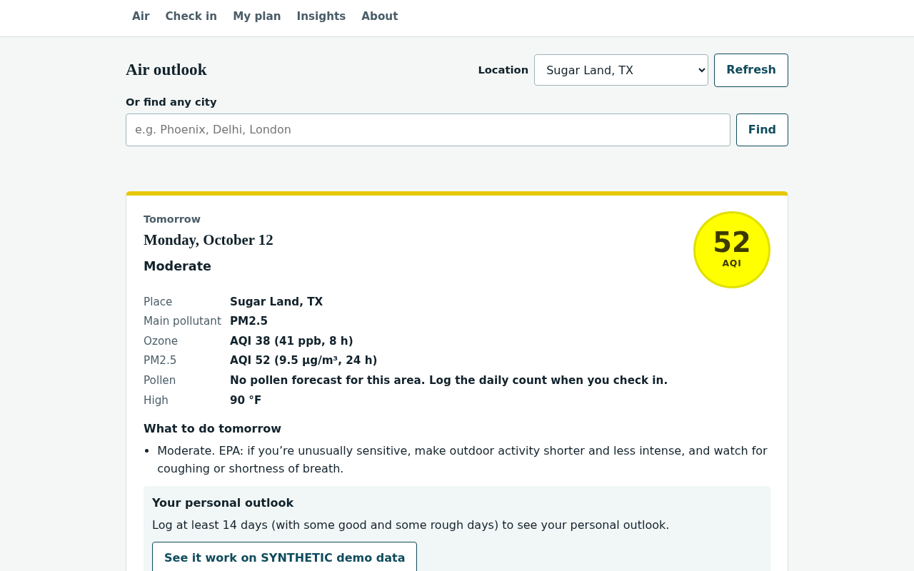

# BreatheEasy

**Live demo:** https://aariv.me/Breatheasy/ (GitHub Pages). Add `?demo=1` for the labelled synthetic demo, or run it locally in one command, see [Run it](#run-it).

BreatheEasy shows tomorrow's air forecast next to your asthma action plan.



*Screenshot of the app served locally with real Open-Meteo data (Oct 2026), taken with headless Chromium.*

BreatheEasy puts two things that usually live apart on one screen: the **asthma action plan** a doctor gives a family (green / yellow / red zones) and **tomorrow's ozone, particle-pollution and pollen forecast** for where you live. Each evening it tells you:

- **Tomorrow's air**: the day's U.S. AQI, computed from the forecast with EPA's own breakpoints, its category, and the pollutant driving it
- **What to do**: EPA's advice for that AQI level for people with asthma, with **your doctor's own words** from your plan beside it (for example, your pre-exercise medicine on an orange ozone day)
- **Your personal outlook**: a small model that learns, **on your device**, which conditions tend to come before *your* rough days, and explains every prediction
- **Which zone you're in today**: a 20-second check-in (peak flow and/or symptoms) that sorts you into your plan's zone, shows that zone's steps, and puts a **Call 911** button in front of you on danger signs

It's in English and Spanish and works on phones. There's no account or server and nothing is tracked; everything stays in your browser.

Built for **DSH Hacks V2** (theme: AI × Healthcare).

> **Not medical advice.** BreatheEasy helps you follow the plan your doctor wrote. It does not diagnose, prescribe, or replace medical care. Trouble walking or talking from shortness of breath, or lips or fingernails that are blue, pale, or gray: call 911 (CDC Asthma Action Plan, 2024).

---

## Quick check for judges

1. Open **https://aariv.me/Breatheasy/** and search any city on the Air tab: tomorrow's AQI, the main pollutant and EPA's advice for it.
2. Tap **See it work on SYNTHETIC demo data** (or open `?demo=1`) to see the personal outlook on clearly labelled SYNTHETIC data. Switch **EN / ES** at the top.
3. Run the tests (Node 18+, no install):
   ```bash
   git clone https://github.com/draarivpatel-ui/Breatheasy && cd Breatheasy
   npm test        # node --test; ends with "# pass 125" and "# fail 0"
   ```
   Optional: `python3 tests/e2e.py` (Playwright) runs 142 headless-Chromium checks against saved real API responses.

## Why

- About **4.8 million U.S. children (6.7%)** have asthma right now, and **47.1%** of children with asthma had at least one asthma attack in the past 12 months ([CDC, Most Recent National Asthma Data, 2023 NHIS](https://www.cdc.gov/asthma/most_recent_national_asthma_data.htm)).
- The American Lung Association's *State of the Air 2026* ranks the **Houston-Pasadena metro 6th worst in the nation for ozone**; Harris County averaged **43.3 weighted unhealthy ozone days per year** in 2022–2024 ([ALA press release, Apr 21 2026](https://www.lung.org/media/press-releases/fy26-sota-texas)).
- EPA lists **people with asthma** and **children and teenagers** among the groups most sensitive to ozone, and its advice for those days is literally "follow your asthma action plan and keep quick-relief medicine handy" ([EPA Air Quality Guide for Ozone](https://document.airnow.gov/air-quality-guide-for-ozone.pdf)).

The plan is on paper in a drawer; the forecast is in a different app. BreatheEasy connects them the night before, when there's still time to move practice indoors or take the pre-exercise medicine the doctor already prescribed.

## How it works

1. **Forecast** – [Open-Meteo Air Quality API](https://open-meteo.com/en/docs/air-quality-api) (Copernicus CAMS model; free, no API key, CORS enabled) for hourly PM2.5, ozone, US AQI and pollen; [Open-Meteo Weather API](https://open-meteo.com/en/docs) for daily high temperature and humidity. Both URLs were verified on 2026-10-10 for Sugar Land, TX; the saved responses are the test fixtures. Any-city search uses the [Open-Meteo Geocoding API](https://open-meteo.com/en/docs/geocoding-api) (GeoNames data; verified 2026-10-11, saved "London" answer is a fixture).
2. **Daily AQI, EPA method** (`js/aqi.js`, `js/forecast.js`)
   - PM2.5: 24-hour mean (needs ≥ 18 of 24 hours), truncated to 0.1 µg/m³.
   - Ozone: highest 8-hour running mean among the 17 periods that start from 7 AM through 11 PM local time, EPA's 2015 data-handling rule (needs ≥ 6 of 8 hours), converted µg/m³ → ppm at 25 °C (`ppb = µg/m³ × 24.45 / 48.00`), truncated to 0.001 ppm.
   - Linear interpolation over the breakpoints in [40 CFR Part 58, App. G, Table 2](https://www.ecfr.gov/current/title-40/chapter-I/subchapter-C/part-58/appendix-Appendix%20G%20to%20Part%2058), including the **2024 PM2.5 update** (Good now ends at 9.0 µg/m³; [EPA fact sheet](https://www.epa.gov/system/files/documents/2024-02/pm-naaqs-air-quality-index-fact-sheet.pdf)). The day's AQI is the higher pollutant.
   - Cross-check: on the real 2026-10-10 Sugar Land forecast, our method gives **140** (8-hour ozone 0.0826 ppm, truncated to 0.082 ppm as EPA requires; the app shows that 82 ppb so the AQI can be checked by hand); Open-Meteo's own peak hourly US AQI was **143**. The app shows both.
3. **Zones** (`js/zones.js`) follow the [NHLBI Asthma Action Plan (2020)](https://www.nhlbi.nih.gov/sites/default/files/publications/Asthma-Action-Plan-2020_rev_508.pdf): green ≥ 80 % of personal-best peak flow, yellow 50–79 %, red < 50 %; the plan's yellow and red symptom lists; the worse of peak flow and symptoms wins; the plan's danger signs trigger a 911 alert, worded as in the [CDC Asthma Action Plan (2024)](https://www.cdc.gov/asthma/action-plan/documents/asthma-action-plan-508.pdf): trouble walking *or* talking, or lips or fingernails that are blue, pale, or gray.
4. **Guidance** (`js/guidance.js`) picks lines from EPA's AQI guidance and NHLBI's trigger tips, plus the text **you** copied from your doctor's plan. The app never generates medication names, doses or treatment steps.
5. **Pollen** – Open-Meteo's pollen forecast covers Europe only, so for U.S. locations the app says so plainly and lets you log the [Houston Health Department daily count](https://www.houstonhealth.org/services/pollen-mold) when you check in. Where grain counts exist they're bucketed with the National Allergy Bureau ranges (tree 15/90/1500, grass 5/20/200, weed 10/50/500 grains/m³; [table](https://forsyth.cc/eap/air_quality/pollen.aspx)).

## How the model works, and what it doesn't do

`js/model.js` is an **L2-regularised logistic regression** trained **in the browser** by gradient descent on your own check-ins. Nothing leaves the device.

- **Label:** a day is "rough" if your check-in put you in the yellow or red zone.
- **Features:** that day's ozone AQI, PM2.5 AQI, pollen level, high temperature, humidity, and whether the day before was rough. Features are standardised; missing values are imputed at the mean, so they contribute exactly zero.
- **Explainable:** every prediction is broken into per-feature contributions (weight × standardised value) that add up exactly to the model's logit, so "Why tomorrow looks high" lists the real reasons. The Insights tab shows the learned weights as a bar chart plus an accessible table.
- **Waits for enough data:** it refuses to predict until it has **14 days with at least 3 rough and 3 good days**. It reports accuracy on the **most recent 25 % of days it never trained on**, next to the "always guess the most common answer" baseline.
- **Calibrated, and checked on SYNTHETIC data where the truth is known.** `js/validate.js` makes up 12 people (seeds 101–112), 200 days each, with the same hidden pattern, trains the model on their logged days and scores it **only on the 100 days that come after** (no peeking at the future). The Insights tab draws the results, tagged SYNTHETIC, with a data table behind each chart:
  - **Reliability plot (calibration)** after 60 logged days, 1,200 held-out days: when the model says 0–20 % / 20–40 % / 40–60 % / 60–80 % / 80–100 %, the share of days that were actually rough is 14 % / 25 % / 42 % / 73 % / 89 % (its average prediction in those bins: 15 / 31 / 50 / 70 / 88 %). Expected calibration error **3.8 percentage points**; it said 57 % on average and 55 % of days were rough. It runs slightly high in the middle bins.
  - **Brier score** (lower is better) on those held-out days: **0.172**, vs. **0.252** for guessing each person's usual rate every day and **0.157** for the best possible score (the generator's own hidden probabilities).
  - **Sensitivity to the number of logged days:**

    | Logged days | 14 | 21 | 30 | 45 | 60 | 90 |
    |---|---|---|---|---|---|---|
    | Model right | 62 % | 70 % | 72 % | 73 % | 75 % | 75 % |
    | Always guess the common answer | 49 % | 49 % | 51 % | 56 % | 52 % | 53 % |
    | Brier | 0.252 | 0.195 | 0.184 | 0.179 | 0.172 | 0.171 |

    Best possible with the hidden pattern: 77 % / Brier 0.157. At 14 days, 1 of the 12 people had too few rough or good days, so the model waited (as it does in the app). Two weeks is a weak model; about three to four weeks is where it settles.
  - These numbers show the method works **when a pattern exists**. Real logs can be noisier, depend on triggers the app does not measure, or have no pattern at all. It is not a clinical validation.
- **Explain any past day.** Pick any logged day (or tap *Explain* in Recent check-ins) to see the starting point (an average day in that log), each condition's push in log-odds with its odds multiplier (for example "Pollen level: High ▲ ×3.02 odds"), and the result. It also shows what a model trained **only on the days before** that one would have said, so you can see whether it would have seen the day coming. The text says it shows what the model weighed, not what caused the day.
- **Demo data is synthetic and labelled.** *Load synthetic demo data* (or `?demo=1`) generates 75 made-up days from a seeded random process in `js/demo.js` in which the invented person reacts to ozone, pollen and heat but not humidity. A dashed banner says SYNTHETIC whenever it's shown. On that data the model ranks pollen and ozone as the top two links and scores 84 % held-out accuracy vs. a 68 % baseline (19 held-out days; Brier 0.12). That shows the pipeline works; it says nothing about real patients.
- **Not a medical device.** It finds associations in one person's log; links are not proof of cause, and the risk bands (low < 35 % ≤ elevated < 60 % ≤ high) are a design choice, not clinical thresholds.

## Features

- Tomorrow card with AQI badge in EPA colors, category, main pollutant, ozone ppb, PM2.5 µg/m³, pollen, high temperature
- 4-day strip (today + 3)
- Locations: Sugar Land, Houston, Pasadena, device geolocation, or **any city in the world** by name (Open-Meteo Geocoding API, free, no key; biggest matches first, up to 5 choices; the choice is remembered on this device). The AQI is always computed with the U.S. EPA method, wherever the city is
- **One-tap AI preview**: on a first visit the personal-outlook box on the Air card offers *See it work on SYNTHETIC demo data*, so the model's outlook appears right on tomorrow's card (with a purple SYNTHETIC tag) without opening Insights; *Remove demo data* in Insights takes it away
- Daily check-in → zone, % of personal best, your plan's steps for that zone, 911 / doctor call buttons
- My plan: personal best (with the zone cut-offs computed live), green / yellow / red text, pre-exercise medicine, doctor's phone, known triggers
- Insights: model status, explanation for tomorrow, learned weights, held-out evaluation with Brier score, recent history
- **Explain a past day**: feature-by-feature breakdown for any logged day, plus what the model would have said using only earlier days
- **How much can you trust it?** SYNTHETIC calibration (reliability plot + Brier) and a sensitivity curve of accuracy vs. number of logged days
- **Installable and offline (PWA)**: `manifest.webmanifest` + `sw.js`. Add it to the home screen; with no signal it still opens, your plan, check-ins and insights all work, and a forecast saved in the last 3 hours is shown with a "You're offline" note and its age. An older forecast is not shown: the app says there is no air-quality data until it can reach Open-Meteo again. Cache-busting: `node scripts/stamp.js` writes a content hash into `sw.js` and every `?v=` in `index.html`, so each deploy gets fresh URLs and a fresh cache (old caches are deleted; a unit test fails if the stamp is stale). Pages are network-first; the forecast APIs are never cached by the service worker
- **Slow or no network**: every Open-Meteo request gives up after 8 seconds (AbortController, plus a timer so a stuck request can never hang the app). On a timeout the last good forecast for that place stays on screen with a plain EN/ES note ("Open-Meteo didn't answer within 8 seconds. Showing the last good forecast (as of 40 min ago)."); offline gets "You're offline" with the same age label. Both go through the same per-place cache as the 429 fallback (`js/fccache.js`).
- **Rate limits and outages (429)**: `js/fccache.js` keeps the last good forecast for each place in localStorage. For 30 minutes it is reused without a new request (Refresh forces one), which also keeps the app under Open-Meteo's rate limit. If Open-Meteo returns 429 or fails, the saved answer is shown for up to 3 hours with an honest "as of N min ago" label ("de hace N min" in Spanish). Past 3 hours, or with nothing saved, the app says plainly that there is no air-quality data right now, and it never shows another city's forecast.
- **Add to calendar** (.ics all-day event for tomorrow with the plan text) and **Print plan**
- **Share with coach or nurse**: one tap turns tomorrow's card into a plain-text note (date, place, AQI and category, the EPA/NHLBI lines, the user's own pre-exercise text, the not-medical-advice and 911 lines). Uses the phone's share sheet when there is one, otherwise copies to the clipboard; the note stays on screen to edit first
- When there's no pollen forecast (all U.S. locations), a pollen level logged in today's check-in is carried to tomorrow's card and the model's explanation, and labelled "today's logged count" so it is never mistaken for a forecast
- English / Español (all UI strings; a test checks every key and placeholder, and that no English is copied into the Spanish strings apart from proper nouns and URLs; the e2e run checks the city-search, SYNTHETIC demo, 8 s timeout, offline and saved-forecast messages in Spanish at 390 px). Spanish medical terms follow the CDC *Plan de acción para el control del asma* (sibilancias, dificultad para respirar, alivio rápido, signos de peligro, mejor puntuación), NHLBI's Spanish asthma pages (opresión en el pecho, desencadenantes) and AirNow español for AQI categories (Insalubre para grupos sensibles / Insalubre / Muy insalubre); a test guards against the retired terms. An open share note re-writes itself when you switch language, unless you have edited it.
- Export data as JSON; delete everything in one tap
- Clear error when the forecast can't load (e.g. Open-Meteo's daily rate limit), with the last saved forecast kept

## Tech

- Plain **HTML, CSS and JavaScript** (classic scripts). No framework, no build step, no backend, no API keys, no tracking.
- On-device machine learning: a hand-written logistic regression in `js/model.js` (no ML library), trained in the browser on the user's own check-ins.
- **PWA**: `manifest.webmanifest` + `sw.js` for install and offline use; `scripts/stamp.js` for cache-busting.
- Data in `localStorage` only; JSON export and one-tap delete.
- Tests: Node's built-in test runner (`node --test`) and Playwright driving headless Chromium.

## Accessibility

Semantic landmarks and headings, skip link, every control labelled, live regions for results, color never the only signal (every AQI color carries its category name; every zone its name), touch targets at least 44 px tall on buttons, tabs, form fields and city search (the inline "Call 911" link and the small "Explain" buttons are at least 40 px; the e2e run checks every button is ≥ 40 px and the search controls ≥ 44 px), visible focus rings, `prefers-reduced-motion` respected, `lang` switches with the language, chart mirrored by a data table for screen readers. Mobile-first and tested at 390 px.

> **Maintainer note:** if the live link 404s, GitHub Pages is not enabled yet. In the repo go to Settings > Pages > Build and deployment > Source: Deploy from a branch > `main` / `(root)` > Save. It goes live in about a minute.

## Run it

It's a static site: open `index.html`, or serve the folder:

```bash
python3 -m http.server 8000   # then http://localhost:8000
```

Useful URL parameters: `?demo=1` loads the labelled synthetic demo; `?today=YYYY-MM-DD` pins "today" (used by the tests).

## Tests

Last run Oct 12, 2026: **125/125 unit tests, 142/142 end-to-end checks, 42/42 print checks and 48/48 saved-data checks passing**. GitHub Actions (`.github/workflows/tests.yml`) runs every suite below on every push to `main`.

```bash
node --test tests/*.test.js                          # 125 unit tests: AQI math (incl. every worked example in EPA's AQI Technical Assistance Document), zones, forecast parsing, 8 s Open-Meteo timeout (AbortController), per-place forecast cache (429 / timeout fallback, 30 min / 3 h limits, EN/ES "as of" labels), model, explain-a-day, SYNTHETIC calibration + sensitivity, PWA manifest / service worker / cache-busting stamp, guidance, i18n, .ics (UTF-8 byte folding at 75 octets, EN/ES), share note, city search (URL, ranking, labels, same-looking places told apart by county or coordinates), EN/ES key parity (same keys and placeholders, no English copied into Spanish), EN/ES "Why BreatheEasy" parity (same model inputs as js/model.js, same numbers and links), and every number quoted on the submitted Devpost page re-computed from the code (tests/devpost-claims.test.js), and a table of saved data from an older or hand-edited copy (js/store.js: a string, a list, an unknown language or place, bad diary rows dropped one by one, impossible ?today= dates), and the link preview (Open Graph + large Twitter card with a real 1280x800 screenshot)
CHROMIUM_PATH=/usr/bin/chromium python3 tests/e2e.py # 142 headless-Chromium checks (pip install playwright)
CHROMIUM_PATH=/usr/bin/chromium python3 tests/axe_states.py # 220 checks: axe-core 0 violations in 11 states (first load, demo, check-in errors/saved, plan errors/saved, city results/not found/search down, forecast 429, offline) x 390/1280 px x EN/ES, again after switching language mid-flow
CHROMIUM_PATH=/usr/bin/chromium python3 tests/lang_flash.py # 14 checks: a Spanish user (saved choice or browser language) never sees the English page flash before js/app.js runs; 3 s fail-safe; corrupt saved data can't hide the page
CHROMIUM_PATH=/usr/bin/chromium python3 tests/edge.py # 60 checks at 390 px, EN/ES: peak flow 49/901/410.5/-5/1e3/0 and personal best 0/49/901/99999 refused with a message (box marked, nothing saved), 50/900/blank accepted; tomorrow's check-in refused; the error, "Plan saved", the check-in result and "All data deleted" all re-worded when you switch language
CHROMIUM_PATH=/usr/bin/chromium python3 tests/saved_state.py # 48 checks at 390 px: 14 broken saved copies (not JSON, a string, lang 'fr', unknown place, diary as an object, bad rows + 1 good ...), a broken demo diary and 4 impossible ?today= dates -> no script error, forecast card renders, good rows kept, the next check-in saves into a clean copy
CHROMIUM_PATH=/usr/bin/chromium python3 tests/print_test.py # 42 checks: Print plan on ONE Letter page in English and Spanish (plain, SYNTHETIC demo, long personal plan + every trigger), with the place, AQI, 911 line, SYNTHETIC label and the user's own words, and no on-screen controls (needs pdfinfo/pdftotext)
node scripts/stamp.js                                # after any change to app files: refresh the cache-busting hash
LIVE=1 CHROMIUM_PATH=/usr/bin/chromium python3 tests/e2e.py   # also hits the real Open-Meteo APIs once
```

- Unit tests use EPA's own worked examples from the [AQI Technical Assistance Document](https://document.airnow.gov/technical-assistance-document-for-the-reporting-of-daily-air-quailty.pdf) (8-h ozone 0.07853333 ppm → AQI 126; ozone 0.078 ppm + PM2.5 35.9 µg/m³ → 126 and 102, AQI 126 with ozone as the main pollutant), the 17-period 8-hour ozone rule, every breakpoint edge, and the saved real Open-Meteo response.
- The e2e test routes Open-Meteo calls to the fixtures and checks real flows: tomorrow's AQI 140 / orange card, the user's pre-exercise text appearing on a USG day, check-in zones (75 % → yellow, danger sign → red + 911), demo model recovering the planted pattern, .ics download, the coach/nurse share note, the labelled logged-pollen carry-over, Spanish, persistence across reload, labels and accessible names, no horizontal overflow at 390 px, 40 px+ touch targets, no JS errors, no network calls except Open-Meteo, and the API-failure message. It also checks the explain-a-day view (8 rows, odds multipliers, the "before" prediction, Explain buttons), the SYNTHETIC trust card (reliability plot, 6-size sensitivity table, Brier line), and, over a local http server, the installable/offline flow: manifest served, service worker in control, one cache named with the current hash, no forecast API cached, and an offline reload that still renders tomorrow's card with the offline note. A 429 section answers Open-Meteo with "rate limit exceeded" after a good load and checks the saved forecast stays on screen labelled "as of 45 min ago" / "de hace 45 min", then that a 3 h 15 min old copy is dropped for a clear no-data message. A slow/offline section holds the Open-Meteo requests unanswered and checks the app gives up after about 8 s, keeps the saved forecast on screen with "didn't answer within 8 seconds" / "no respondió en 8 segundos" and its age, shows a no-data message naming the timeout when nothing is saved, recovers on Refresh, and with the network cut answers at once with the "You're offline" / "sin conexión" note while keeping the last result.

## Files

```
index.html          markup (EN + ES about text)
styles.css          styles, mobile-first, print stylesheet
js/aqi.js           EPA AQI breakpoints + math
js/forecast.js      Open-Meteo fetch + daily EPA-method summaries
js/fccache.js       per-place forecast cache: 30 min fresh, 3 h fallback on 429/outage, "as of" age
js/zones.js         NHLBI action-plan zones
js/store.js         saved-data guard: an older or hand-edited copy is cleaned up on load, never trusted as-is
js/guidance.js      which cited guidance lines apply
js/model.js         on-device logistic regression + explanations + evaluation
js/demo.js          seeded SYNTHETIC demo generator
js/validate.js      SYNTHETIC model check: reliability, Brier, sensitivity to logged days
sw.js               service worker (offline, cache-busting by content hash)
manifest.webmanifest, icons/   install metadata + app icons
scripts/stamp.js    writes the content hash into sw.js and index.html
js/ics.js           calendar export
js/share.js         plain-text note for a coach / school nurse
js/places.js        any-city search (Open-Meteo Geocoding): URL, ranking, labels
js/i18n.js          English / Spanish strings
js/app.js           UI wiring, localStorage
tests/              node unit tests, Playwright e2e, real API fixtures
onepager.pdf        one-page project description (DSH Hacks submission)
```

## Limits

- Forecasts are model estimates (CAMS via Open-Meteo, ~11 km grid), not monitor readings. Official local forecasts and Ozone Action Days: [AirNow](https://www.airnow.gov/).
- Ozone above 0.200 ppm (8-h) has no EPA 8-hour breakpoint (EPA uses 1-hour ozone for AQI 301+, which the app does not compute); the app caps at 300 (Very Unhealthy). PM2.5 above 325.4 µg/m³ follows EPA's rule and keeps rising past 500 instead of stopping there.
- No U.S. pollen forecast from a free, keyless, CORS-enabled source; pollen is user-logged for U.S. locations.
- The model is only as good as the check-ins; with sparse logs it stays silent. Its calibration and sensitivity numbers come from SYNTHETIC people with a planted pattern, not from patients.
- Offline, the app shows a forecast saved on this device only if it is under 3 hours old; it cannot get a new forecast without a connection, and after 3 hours it shows no forecast at all rather than a stale one.
- If a data source is down, the app says so instead of guessing.
- BreatheEasy is information, not clinical advice. Follow your own asthma action plan and clinician.

## AI-assistance disclosure

This project was built with help from an AI coding assistant (Hark), which drafted code, tests and copy under Aariv Patel's direction. Every statistic and guideline above was checked against the linked source pages.

## Data sources

- **Forecast:** Open-Meteo Air Quality API (Copernicus CAMS: hourly PM2.5, ozone, US AQI, pollen in Europe) and Open-Meteo Weather API (daily high temperature, humidity). Free, keyless, called straight from the browser.
- **Pollen in the U.S.:** logged by the user from the Houston Health Department daily count (no free U.S. pollen forecast exists).
- **Rules:** EPA AQI breakpoints and guidance, NHLBI Asthma Action Plan zones, CDC Spanish asthma terms.
- **Model data:** only the user's own check-ins, on their device. Demo and calibration data are SYNTHETIC and labelled.

## Sources

- NHLBI, [Asthma Action Plan](https://www.nhlbi.nih.gov/resources/asthma-action-plan-2020) (Dec 2020, NIH Pub. No. 20-HL-5251)
- CDC, [Most Recent National Asthma Data](https://www.cdc.gov/asthma/most_recent_national_asthma_data.htm) (2023 NHIS; page updated Oct 6 2026)
- American Lung Association, [State of the Air 2026 – Texas](https://www.lung.org/media/press-releases/fy26-sota-texas)
- U.S. EPA, [40 CFR Part 58 App. G](https://www.ecfr.gov/current/title-40/chapter-I/subchapter-C/part-58/appendix-Appendix%20G%20to%20Part%2058), [AQI Basics](https://www.airnow.gov/aqi/aqi-basics/), [Air Quality Guide for Ozone](https://document.airnow.gov/air-quality-guide-for-ozone.pdf), [2024 PM AQI fact sheet](https://www.epa.gov/system/files/documents/2024-02/pm-naaqs-air-quality-index-fact-sheet.pdf)
- Houston Health Department, [Pollen and Mold Reports](https://www.houstonhealth.org/services/pollen-mold)
- Open-Meteo, [Air Quality API](https://open-meteo.com/en/docs/air-quality-api) (data: Copernicus CAMS, CC BY 4.0) and [Weather API](https://open-meteo.com/en/docs)

MIT License.
